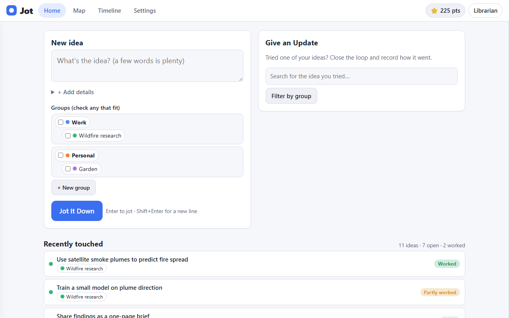
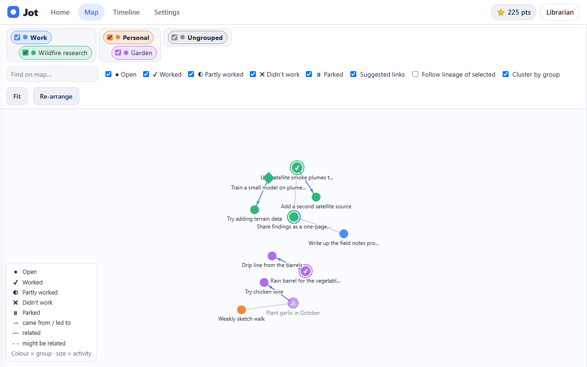

# Jot

A place to jot your ideas down, then watch them mingle: group them, connect
them, brainstorm them, try them, and follow how one idea led to the next.

Jot runs **on your own computer**, in your browser. Your ideas are stored in one
folder (`jot_data`) and go nowhere. It works completely **offline**; an AI is an
optional extra.

## What it does

- **Jot It Down.** Type a few words, tick the groups it belongs to, press the
  button. Earn points.
- **Groups (families).** Groups can sit inside groups: *Work › Wildfire research*,
  *Personal › Soccer*. An idea can be in several. Make new ones right from the jot form.
- **Map.** An Obsidian-style network of all your ideas. Tick groups at the top to
  show or hide them. Colour is the group, size is how much you've worked on the
  idea, and the shape shows how it turned out. Drag, zoom, click an idea to open it.
- **Sidebar.** Click an idea to write notes (with Markdown), attach files, paste or
  drop images straight into your notes, and connect it to other ideas.
- **Give an Update.** Tried an idea? Search for it (optionally filtered by group),
  say whether it worked, what went well and badly, what to improve, and what new
  ideas came out of it. Those new ideas are linked back, so the map shows **lineage**:
  arrows from parent to child, with colour/shape/fade showing which succeeded.
- **Brainstorm.** A thinking partner asks about your idea with four answer options
  plus a box to write your own. The more thought in your answer, the more points.
- **Librarian.** Ask "do I already have an idea like this?" It shows what matches, which
  groups they're in, whether it should be a new Jot, and highlights them in blue on the
  map or the timeline.
- **Timeline.** Everything you've done, newest first, filterable by group and type.
- **Themes.** Light, dark or automatic, plus six colour themes.

## Install and run

You need Python 3.10 or newer ([python.org](https://www.python.org/downloads/); on
Windows tick *Add python.exe to PATH*).
The first run installs its one small dependency (Flask) into a private `.venv` folder next to Jot; nothing else on your computer is touched.

- **Windows:** double-click `run.bat`. The first time it sets itself up (a minute).
- **Mac / Linux:** `./run.sh`

Your browser opens to http://127.0.0.1:5057. Leave the window open while you use
Jot; close it to stop.

## Adding an AI (optional)

Without one, Jot uses guided brainstorming prompts, keyword matching for the
librarian and suggested connections. With one, you get
questions written for each of your ideas, a librarian that understands meaning,
and AI-suggested connections.

1. Copy `.env.example` to `.env`.
2. Set `JOT_PROVIDER` to `tamu`, `openai`, `openrouter`, `ollama` or `custom`
   (any OpenAI-compatible service), and add the matching key. For a model on your own
   computer, use `ollama` and no key is needed.
3. Restart Jot. Settings shows what's connected and has a *Test connection* button.

Only the text of ideas you ask the AI about is sent. Your key stays in `.env`
(git-ignored) and never in the code. You can switch the AI off any time in Settings.

## Make it yours

Everything is plain files; no build step.

| To change... | Edit |
|---|---|
| Button and tab labels, status names, theme list | `static/config.js` |
| Colours, spacing, add a theme | `static/style.css` (look for `data-palette`) |
| Point values | `config.py` |
| The questions asked without an AI | `questions.py` |
| What the AI is told to do | `prompts.py` |
| Where data is stored, port | `.env` (`JOT_DATA`, `JOT_PORT`) |

Layout: `app.py` (server and API), `db.py` (database), `llm.py` (AI client),
`textsim.py` (offline matching), and `static/*.js` (one file per screen).

## Your data

Settings → *Download a backup* saves everything (ideas, notes, files, points) as one zip; *Restore* loads it back. Or copy the `jot_data` folder.

## License

MIT. See `LICENSE`.
